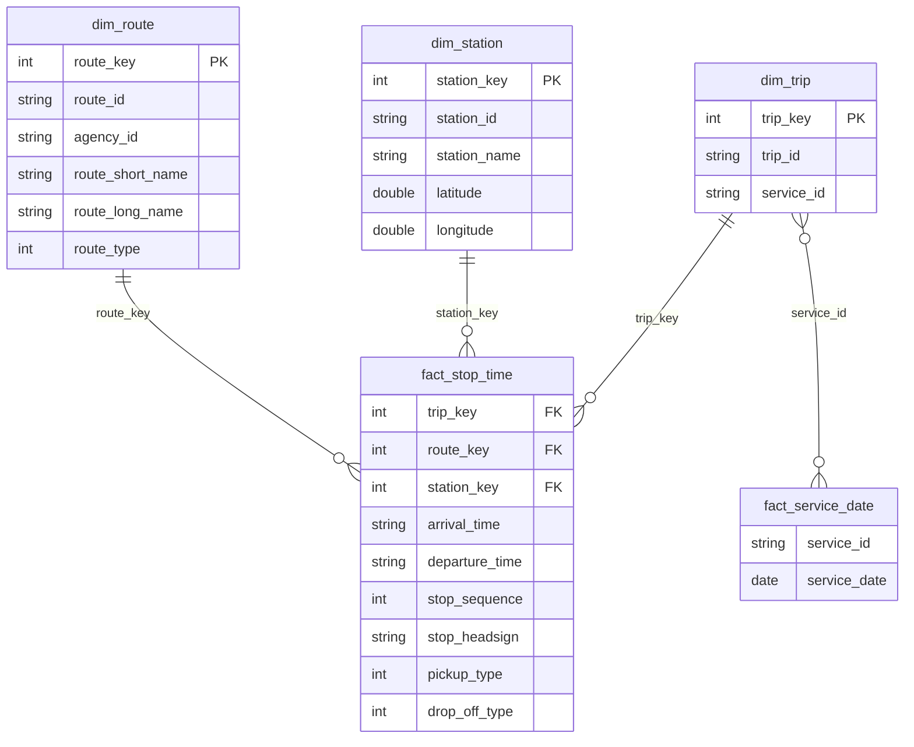
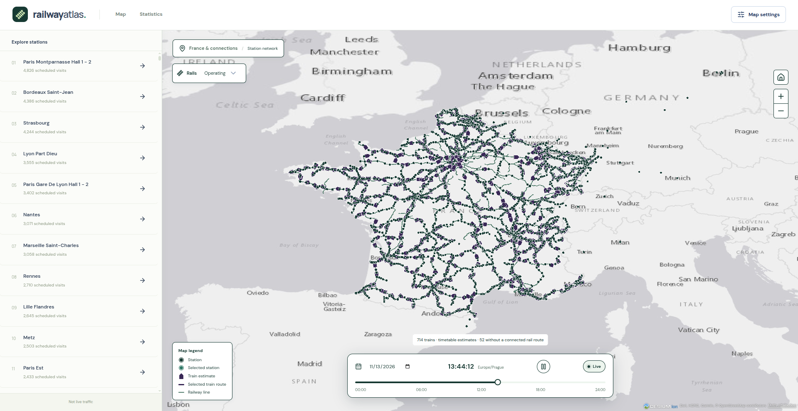

# European Railway Project

## Installation

Prerequisites: Docker with the Compose plugin, Git, and an internet connection for downloading images, build dependencies, and railway data.

1. Clone the repository and change into its directory.
2. Create `infra/lakehouse/.env` with local credentials and a JWT secret:

   ```dotenv
   MINIO_ROOT_USER=railway_admin
   MINIO_ROOT_PASSWORD=railway_admin
   S3_BUCKET=railway
   POSTGRES_PASSWORD=choose_a_password
   AIRFLOW_JWT_SECRET=replace_with_a_random_secret
   ```

   Generate a random JWT secret with `openssl rand -hex 32` and use its output for `AIRFLOW_JWT_SECRET`. The MinIO credentials above match the local defaults listed below; change them if needed.

3. From the project root, start the lakehouse first, followed by the application stack:

   ```bash
   docker compose --env-file infra/lakehouse/.env -f infra/lakehouse/compose.yml up -d --build
   docker compose --env-file infra/lakehouse/.env up -d --build
   ```

   The first build can take several minutes. The lakehouse stack creates the shared Docker network used by the application stack.

4. Open Airflow using the address below, unpause and trigger `railway_pipeline` to load the schedule data. Trigger `rfn_lines_download` to load the railway infrastructure used by the map.

## Local services and access

| Service | Local address | Purpose |
| --- | --- | --- |
| Airflow | [localhost:7001](http://localhost:7001) | Airflow web interface and API |
| Metabase | [localhost:7002](http://localhost:7002) | Analytics dashboard |
| MinIO Console | [localhost:7003](http://localhost:7003) | Object storage web interface |
| MinIO API | [localhost:7004](http://localhost:7004) | Object storage API |
| Iceberg catalog database | [localhost:7005](http://localhost:7005) | PostgreSQL catalog |
| Trino | [localhost:7006](http://localhost:7006) | SQL queries over the Iceberg lakehouse |
| Railway Atlas | [localhost:7007](http://localhost:7007) | Nuxt station map with a Nitro API |

These ports are bound to `127.0.0.1` and are accessible from the local machine. The Airflow PostgreSQL database and Airflow background services do not publish ports to the host.

To connect Metabase, select **Starburst (Trino)** and use host `trino`, port `8080`, catalog `railway`, username `admin`, and no password or SSL for this local setup. Use `gold` as the schema if requested. The `localhost:7006` address is for connections from the host machine; Metabase runs in Docker.

Trino reads the current Iceberg table snapshots, which can differ from the latest complete Gold release while a pipeline run is publishing or after a partial failure.

| Service | Username | Password |
| --- | --- | --- |
| Airflow | `admin` | `22KVGfcDGhrMuVRM` |
| MinIO | `railway_admin` | `railway_admin` |
| Iceberg catalog database | `iceberg` | `railway_admin` |
| Metabase | Set during initial setup | Set during initial setup |
| Trino | `admin` | No password |

## Dimensional model

The Gold layer uses a galaxy schema (fact constellation) with two fact tables. `fact_stop_time` links to the route, station, and trip dimensions, while `fact_service_date` links to trips through the shared `service_id`.



### `dim_route`

- `route_key`: Warehouse key for the route.
- `route_id`: GTFS route identifier.
- `agency_id`: Identifier of the agency operating the route.
- `route_short_name`: Short public-facing route name.
- `route_long_name`: Longer route name.
- `route_type`: GTFS transport mode code.
- `agency_name`: Agency name.
- `agency_url`: Agency website.
- `agency_timezone`: Agency time zone.
- `agency_lang`: Agency language code.

### `dim_station`

- `station_key`: Warehouse key for the station.
- `station_id`: GTFS identifier for the station area.
- `station_name`: Station name.
- `latitude`: Station latitude.
- `longitude`: Station longitude.

### `dim_trip`

- `trip_key`: Warehouse key for the trip.
- `trip_id`: GTFS trip identifier.
- `service_id`: Identifier of the service calendar for the trip.
- `trip_headsign`: Destination or direction displayed to passengers.
- `direction_id`: GTFS direction indicator.
- `block_id`: Identifier grouping trips assigned to the same vehicle.

### `fact_stop_time`

Grain: One row per stop visit within a scheduled trip.

- `trip_key`: Key of the trip visiting the stop.
- `route_key`: Key of the trip's route.
- `station_key`: Key of the station where the stop occurs.
- `arrival_time`: Scheduled arrival time in GTFS format.
- `departure_time`: Scheduled departure time in GTFS format.
- `stop_sequence`: Order of the stop within the trip.
- `stop_headsign`: Passenger-facing destination text for the stop.
- `pickup_type`: GTFS code describing passenger pickup.
- `drop_off_type`: GTFS code describing passenger drop-off.

### `fact_service_date`

Grain: One row per active service and date.

- `service_id`: Identifier of the active service.
- `service_date`: Date on which the service operates.

## Railway Atlas

Railway Atlas is the project's frontend, built with Nuxt and CesiumJS. It provides an interactive map of stations and railway infrastructure, station timetables, estimated train positions, and network statistics.



## Contact

David Valek — [david.valek17@gmail.com](mailto:david.valek17@gmail.com)
