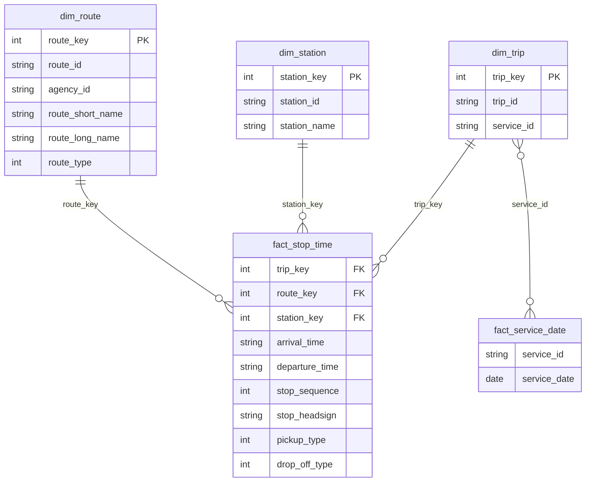

# European Railway Project

## Service ports

| Service | Local address | Purpose |
| --- | --- | --- |
| Airflow | http://localhost:7001 | Airflow web interface and API |
| Metabase | http://localhost:7002 | Analytics dashboard |
| MinIO API | http://localhost:7004 | Object storage API |
| MinIO Console | http://localhost:7003 | Object storage web interface |
| Iceberg catalog database | localhost:7005 | PostgreSQL catalog |

These ports are bound to `127.0.0.1` and are accessible from the local machine. The Airflow PostgreSQL database and Airflow background services do not publish ports to the host.

| Service | Username | Password |
| --- | --- | --- |
| Airflow | `admin` | `22KVGfcDGhrMuVRM` |
| MinIO | `railway_admin` | `railway_admin` |
| Iceberg catalog database | `iceberg` | `railway_admin` |
| Metabase | Set during initial setup | Set during initial setup |

## Gold layer

`fact_stop_time` contains one row per stop visit. `fact_service_date` contains one row per active service and date and joins to trips through `service_id`. The diagram shows the principal fields; dimension attributes may also include additional source columns.
