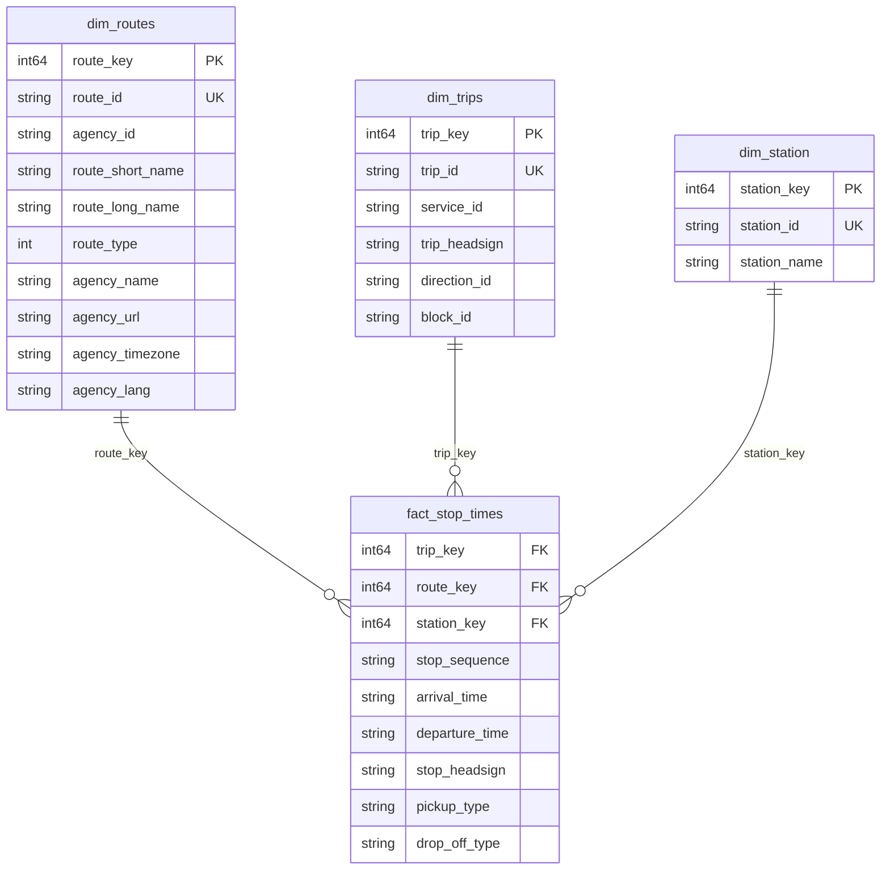

# Dimensional Model

The curated layer uses a star schema with three dimensions and one fact table centered on scheduled station visits. Dimension tables use integer surrogate keys; GTFS identifiers are retained as business keys. The current pipeline writes source values as strings except for dimension surrogate keys, so the types below describe the curated Parquet outputs.

## `dim_routes`

**Grain:** one row per GTFS route. Agency attributes are embedded in this dimension.

```text
dim_routes(
  route_key: int64,
  route_id: string,
  agency_id: string,
  route_short_name: string,
  route_long_name: string,
  route_type: Int64,
  agency_name: string,
  agency_url: string,
  agency_timezone: string,
  agency_lang: string
)
```

| Column | Meaning |
| --- | --- |
| `route_key` | Warehouse surrogate key for the route. |
| `route_id` | GTFS identifier for the route. |
| `agency_id` | Source identifier of the agency operating the route; an attribute rather than a dimension foreign key. |
| `agency_name` | Agency display name. |
| `agency_url` | Agency website. |
| `agency_timezone` | Agency time zone. |
| `agency_lang` | Agency primary language code. |
| `route_short_name` | Short public-facing route label, when provided. |
| `route_long_name` | Longer route name or description. |
| `route_type` | GTFS transport mode code (for example, rail or bus). Nullable integer in the current dimension build. |

| route_key | route_id | agency_id | route_short_name | route_long_name | route_type |
| ---: | --- | --- | --- | --- | ---: |
| 1 | FR:Line::example: | 1187 | c30 | saint-étienne - roanne | 2 |

## `dim_station`

**Grain:** one row per GTFS station area (`StopArea:` stop).

```text
dim_station(
  station_key: int64,
  station_id: string,
  station_name: string
)
```

| Column | Meaning |
| --- | --- |
| `station_key` | Warehouse surrogate key for the station. |
| `station_id` | GTFS stop ID for the station area. |
| `station_name` | Station name, normalized to lowercase by the current build. |

| station_key | station_id | station_name |
| ---: | --- | --- |
| 1 | StopArea:OCE71043075 | figueres-vilafant |

## `dim_trips`

**Grain:** one row per scheduled GTFS trip. Existing trip IDs retain their surrogate keys; new trips receive keys above the current maximum. Attributes are updated in place.

```text
dim_trips(
  trip_key: int64,
  service_id: string,
  trip_id: string,
  trip_headsign: string,
  direction_id: string,
  block_id: string
)
```

| Column | Meaning |
| --- | --- |
| `trip_key` | Stable warehouse surrogate key for the trip. |
| `service_id` | GTFS service calendar identifier that determines when the trip runs. |
| `trip_id` | GTFS identifier for this scheduled trip. |
| `trip_headsign` | Destination or direction text shown to passengers. |
| `direction_id` | GTFS direction indicator, if supplied. |
| `block_id` | GTFS block identifier grouping trips assigned to the same vehicle, if supplied. |

| trip_key | trip_id | service_id | trip_headsign | direction_id |
| --- | --- | --- | --- | --- |
| 1 | OCESN105241F1187_example | 000001 | 105241 | 0 |

## `fact_stop_times`

**Grain:** one row per stop visit within a scheduled trip (identified by `trip_key` and `stop_sequence`).

```text
fact_stop_times(
  trip_key: int64,
  route_key: int64,
  station_key: int64,
  arrival_time: string,
  departure_time: string,
  stop_sequence: string,
  stop_headsign: string,
  pickup_type: string,
  drop_off_type: string
)
```

| Column | Meaning |
| --- | --- |
| `trip_key` | Surrogate key referencing `dim_trips.trip_key`. |
| `route_key` | Surrogate key referencing `dim_routes.route_key`, resolved through the trip route ID. |
| `station_key` | Station surrogate key resolved through `stops.parent_station`; joins to `dim_station.station_key`. |
| `arrival_time` | Scheduled arrival time at the stop, in GTFS time format. |
| `departure_time` | Scheduled departure time from the stop, in GTFS time format. |
| `stop_sequence` | Stop order within the trip. |
| `stop_headsign` | Stop-specific passenger-facing destination text, if supplied. |
| `pickup_type` | GTFS code describing whether passenger pickup is allowed at this stop. |
| `drop_off_type` | GTFS code describing whether passenger drop-off is allowed at this stop. |

| trip_key | stop_sequence | station_key | arrival_time | departure_time |
| --- | --- | --- | --- | --- |
| 1 | 0 | 123 | 19:54:00 | 19:54:00 |

The example surrogate keys are illustrative; surrogate key values depend on the dimension load.

## Relationships

- Agency attributes are joined from staging into `dim_routes`; there is no separate agency dimension.
- `fact_stop_times.route_key` references `dim_routes.route_key`.
- `fact_stop_times.trip_key` references `dim_trips.trip_key`.
- Dimensions are created before the fact, which resolves GTFS business IDs against the persisted dimension mappings. Unresolved surrogate keys fail the load.
- The trip-to-route association is read from staging `trips.csv` during fact key resolution. `dim_trips` has no route foreign key.
- `fact_stop_times.station_key` references `dim_station.station_key`. During transformation, `stop_times.csv.stop_id` → `stops.csv.stop_id` → `stops.csv.parent_station` → `dim_station.station_id` resolves the key. All 534,561 stop-time rows in the inspected CSVs resolve through this mapping.
- The fact build joins stop times to `stops.csv`, resolves `parent_station` against `dim_station.station_id`, and stores the resulting `station_key` in `fact_stop_times`. Station-area stops without a parent use their own stop ID. The load fails if any fact row cannot resolve to a station key.
- The source `stop_id`, `trip_id`, and `route_id` are dropped from the fact after key resolution. The curated fact represents station visits and does not retain platform-level identity.

Example of the source mapping:

| stop_times.csv.stop_id | stops.parent_station | dim_station.station_name |
| --- | --- | --- |
| StopPoint:OCENavette-87571000 | StopArea:OCE87571000 | tours |
| StopPoint:OCENavette-87571240 | StopArea:OCE87571240 | saint-pierre-des-corps |

- `calendar_dates.txt` and `feed_info.txt` are currently staged as source data and are not modeled as curated tables.

## Model Diagram

The station relationship uses the resolved surrogate key in `fact_stop_times`.


