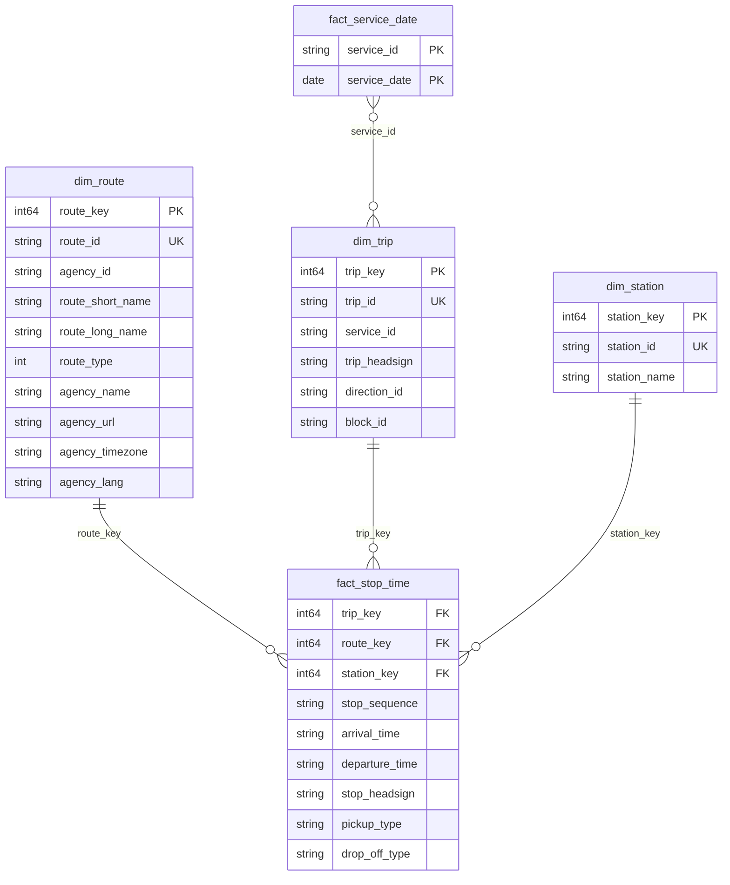

# Dimensional Model

The curated layer uses a star schema with three dimensions, a scheduled station-visit fact table, and a factless service-date fact table. Dimension tables use integer surrogate keys; GTFS identifiers are retained as business keys. The current pipeline writes source values as strings except for dimension surrogate keys, `dim_route.route_type`, and `fact_service_date.service_date` (a date), so the types below describe the curated Parquet outputs.

## Layer boundary

Silver and Gold are Apache Iceberg v2 tables in MinIO under `s3://railway/data/silver/<table>/` and `s3://railway/data/gold/<table>/`. A PostgreSQL SQL catalog stores table metadata pointers; Iceberg metadata, manifests, and Parquet data live in MinIO.

Transform tasks stage temporary Parquet under `/tmp/railway/<run-id>/`. Publishing commits Iceberg snapshots, then publishes a layer release manifest with pinned snapshot IDs. Gold reads the published Silver snapshots, and each Gold dimension reuses the key mapping from the previous complete Gold release. Station selection, enrichment, key allocation, and fact grains remain unchanged. A run creates new snapshots of stable tables, rather than new table identifiers.

## `dim_route`

**Grain:** one row per GTFS route. Agency attributes are embedded in this dimension.

```text
dim_route(
  route_key: int64,
  route_id: string,
  agency_id: string,
  route_short_name: string,
  route_long_name: string,
  route_type: Int64,
  agency_name: string,
  agency_url: string,
  agency_timezone: string,
  agency_lang: string
)
```

| Column | Meaning |
| --- | --- |
| `route_key` | Warehouse surrogate key for the route. |
| `route_id` | GTFS identifier for the route. |
| `agency_id` | Source identifier of the agency operating the route; an attribute rather than a dimension foreign key. |
| `agency_name` | Agency display name. |
| `agency_url` | Agency website. |
| `agency_timezone` | Agency time zone. |
| `agency_lang` | Agency primary language code. |
| `route_short_name` | Short public-facing route label, when provided. |
| `route_long_name` | Longer route name or description. |
| `route_type` | GTFS transport mode code (for example, rail or bus). Nullable integer in the current dimension build. |

| route_key | route_id | agency_id | route_short_name | route_long_name | route_type |
| ---: | --- | --- | --- | --- | ---: |
| 1 | FR:Line::example: | 1187 | c30 | saint-étienne - roanne | 2 |

## `dim_station`

**Grain:** one row per GTFS station area (`StopArea:` stop).

```text
dim_station(
  station_key: int64,
  station_id: string,
  station_name: string
)
```

| Column | Meaning |
| --- | --- |
| `station_key` | Warehouse surrogate key for the station. |
| `station_id` | GTFS stop ID for the station area. |
| `station_name` | Station name, normalized to lowercase by the current build. |

| station_key | station_id | station_name |
| ---: | --- | --- |
| 1 | StopArea:OCE71043075 | figueres-vilafant |

## `dim_trip`

**Grain:** one row per scheduled GTFS trip. Existing trip IDs retain their surrogate keys; new trips receive keys above the current maximum. Attributes are updated in place.

```text
dim_trip(
  trip_key: int64,
  service_id: string,
  trip_id: string,
  trip_headsign: string,
  direction_id: string,
  block_id: string
)
```

| Column | Meaning |
| --- | --- |
| `trip_key` | Stable warehouse surrogate key for the trip. |
| `service_id` | GTFS service calendar identifier that determines when the trip runs. |
| `trip_id` | GTFS identifier for this scheduled trip. |
| `trip_headsign` | Destination or direction text shown to passengers. |
| `direction_id` | GTFS direction indicator, if supplied. |
| `block_id` | GTFS block identifier grouping trips assigned to the same vehicle, if supplied. |

| trip_key | trip_id | service_id | trip_headsign | direction_id |
| --- | --- | --- | --- | --- |
| 1 | OCESN105241F1187_example | 000001 | 105241 | 0 |

## `fact_stop_time`

**Grain:** one row per stop visit within a scheduled trip (identified by `trip_key` and `stop_sequence`).

```text
fact_stop_time(
  trip_key: int64,
  route_key: int64,
  station_key: int64,
  arrival_time: string,
  departure_time: string,
  stop_sequence: string,
  stop_headsign: string,
  pickup_type: string,
  drop_off_type: string
)
```

| Column | Meaning |
| --- | --- |
| `trip_key` | Surrogate key referencing `dim_trip.trip_key`. |
| `route_key` | Surrogate key referencing `dim_route.route_key`, resolved through the trip route ID. |
| `station_key` | Station surrogate key resolved through `stops.parent_station`; joins to `dim_station.station_key`. |
| `arrival_time` | Scheduled arrival time at the stop, in GTFS time format. |
| `departure_time` | Scheduled departure time from the stop, in GTFS time format. |
| `stop_sequence` | Stop order within the trip. |
| `stop_headsign` | Stop-specific passenger-facing destination text, if supplied. |
| `pickup_type` | GTFS code describing whether passenger pickup is allowed at this stop. |
| `drop_off_type` | GTFS code describing whether passenger drop-off is allowed at this stop. |

| trip_key | stop_sequence | station_key | arrival_time | departure_time |
| --- | --- | --- | --- | --- |
| 1 | 0 | 123 | 19:54:00 | 19:54:00 |

The example surrogate keys are illustrative; surrogate key values depend on the dimension load.

## `fact_service_date`

**Grain:** one row per active (`service_id`, `service_date`). This is a factless fact table: a row records that a service operates on a date, with no numeric measure.

```text
fact_service_date(
  service_id: string,
  service_date: date
)
```

`service_id` joins to `dim_trip.service_id`; multiple trips may share a service. `service_date` is the GTFS service day, including departures after midnight belonging to that service day.

The transformation expands weekly schedules from optional `calendar.txt`, then applies `calendar_dates.txt`: type `1` adds a date and type `2` removes it. Without `calendar.txt`, added dates define the schedule directly. Duplicate exception keys and invalid exception types fail the transformation.

For daily route departures, join active services to trips and a distinct (`trip_key`, `route_key`) mapping from `fact_stop_time`. Count each trip once per date, rather than counting stop visits. See `core/railway/analytics/queries/daily_route_departures.sql`. Dates with no departures have no rows.

## Relationships

- Agency attributes are joined from Iceberg `silver.agency` into `dim_route`; there is no separate agency dimension.
- `fact_stop_time.route_key` references `dim_route.route_key`.
- `fact_stop_time.trip_key` references `dim_trip.trip_key`.
- Dimensions are created before the fact, which resolves GTFS business IDs against the persisted dimension mappings. Unresolved surrogate keys fail the load.
- The trip-to-route association is read from Iceberg `silver.trips` during fact key resolution. `dim_trip` has no route foreign key.
- `fact_stop_time.station_key` references `dim_station.station_key`. During transformation, `stop_times.csv.stop_id` → `stops.csv.stop_id` → `stops.csv.parent_station` → `dim_station.station_id` resolves the key. Unresolved station mappings fail the Gold load.
- The fact build joins stop times to `stops.csv`, resolves `parent_station` against `dim_station.station_id`, and stores the resulting `station_key` in `fact_stop_time`. Station-area stops without a parent use their own stop ID. The load fails if any fact row cannot resolve to a station key.
- The source `stop_id`, `trip_id`, and `route_id` are dropped from the fact after key resolution. The curated fact represents station visits and does not retain platform-level identity.

Example of the source mapping:

| stop_times.csv.stop_id | stops.parent_station | dim_station.station_name |
| --- | --- | --- |
| StopPoint:OCENavette-87571000 | StopArea:OCE87571000 | tours |
| StopPoint:OCENavette-87571240 | StopArea:OCE87571240 | saint-pierre-des-corps |

- `calendar_dates.txt` is transformed into `fact_service_date`; `calendar.txt` supplies weekly schedules when present. `feed_info.txt` remains staging-only.

## Model Diagram

The station relationship uses the resolved surrogate key in `fact_stop_time`.


